# TraceWeave - Code Flow Tracker


NOTE: `.\gradlew.bat runIdeLocal` and `verifyPlugin` use your installed IntelliJ IDEA: set its path in `build.gradle.kts` first (see [Find your IntelliJ IDEA installation path](#find-your-intellij-idea-installation-path)). Building and testing need no installed IDE.


## Overview


TraceWeave - Code Flow Tracker is an IntelliJ IDEA plugin by **RameshNR** for following a code path through a Java, Kotlin or Java web project (JSP, JavaScript, TLD and more). While you read code, you click the lines that matter (or let the debugger record them). TraceWeave collects them in a side panel (grouped by file and method, or as one flat sequence), keeps them in **call order** automatically, and copies the whole flow as text, a compact log or a Markdown document. The **Flow Diagram** shows the flow as boxes and arrows you can edit, format and copy as an image. Flows have names, can be exported as `.flow.json` files to share with your team, and can be replayed step by step in the editor.

It works in **IntelliJ IDEA 2023.1 and every later version** (see [Compatibility](#compatibility)). This is a Java Gradle project built with **JDK 17** against **IntelliJ IDEA Community 2023.1**, the oldest supported version. It uses the Gradle wrapper (`gradlew.bat`) to provide the right Gradle version, so you don't need to install Gradle.

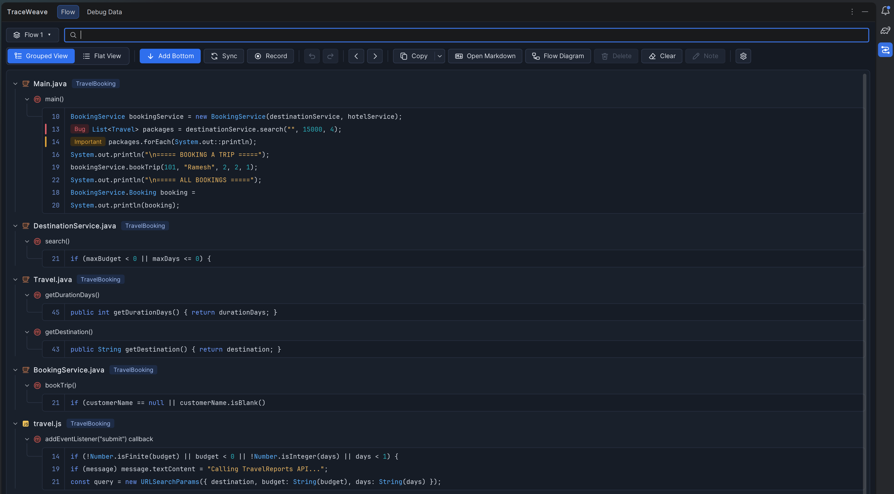


# Prerequisites


Make sure you have the following installed:


- **IntelliJ IDEA 2023.1 or newer** to use the plugin (build `231+`, Community/OSS or Ultimate)
- **JDK 17 or newer** on your `PATH` / `JAVA_HOME` to run Gradle (check with `java -version`)
- **JDK 17** to compile the plugin (optional: Gradle downloads it automatically on the first build if it isn't installed)
- **Gradle 9.6.0** (optional, as this project uses the Gradle wrapper)
- **Internet access** for the first build (Gradle, the IntelliJ IDEA 2023.1 libraries and, if needed, JDK 17 are downloaded once into Gradle's cache)

| Component | Version | Where it is set |
|---|---|---|
| IntelliJ IDEA | 2023.1+ (`sinceBuild = 231`, no upper limit) | `build.gradle.kts` → `ideaVersion` |
| Compiled against | IntelliJ IDEA Community 2023.1.7 | `build.gradle.kts` → `intellijIdeaCommunity(...)` |
| Java (plugin code) | 17 (what IntelliJ IDEA 2023.x runs on) | `build.gradle.kts` → `java.toolchain` |
| Gradle | 9.6.0 | `gradle/wrapper/gradle-wrapper.properties` |
| IntelliJ Platform Gradle Plugin | 2.19.0 | `build.gradle.kts` → `plugins` |
| Plugin version | 1.3.0 | `build.gradle.kts` → `version` |
| Plugin ID | `io.github.rameshnr.flowtracker` (kept from Flow Tracker; never change it once published) | `plugin.xml` → `<id>` |


## Installation


**Just use the plugin:** download `traceweave-code-flow-tracker-<version>.zip` from the [latest release](https://github.com/RameshNR/traceweave/releases/latest) (don't unzip it), then in IntelliJ IDEA 2023.1 or later go to **Settings → Plugins → ⚙️ → Install Plugin from Disk…**, pick the zip and restart the IDE.

**Build it yourself:**

- Copy or clone this repository to any folder, for example `C:/Projects/traceweave`
- Open `build.gradle.kts` and set the two `local("...")` / `localPath` paths to **your** IntelliJ IDEA installation (see the next section):
  ```kotlin
  localPath = file("C:/Users/<you>/AppData/Local/Programs/IntelliJ IDEA OSS")
  ```
- Open PowerShell in the `traceweave` folder (the one that contains `gradlew.bat`)
- Start a sandbox of your installed IntelliJ with the plugin installed (the first run takes a few minutes):
  ```shell
  .\gradlew.bat runIdeLocal
  ```
  (`.\gradlew.bat runIde` starts IntelliJ IDEA 2023.1 instead, the oldest supported version.)
- In the sandbox IDE, open a Java project, then open **TraceWeave** from the right-hand tool window bar
- Hover a line in a source file (for example a `.java`, `.kt`, `.jsp`, `.js` or `.tld` file) and click the **+** in the gutter

To build the installable plugin instead, see [Build the plugin](#build-the-plugin).


## Find your IntelliJ IDEA installation path


`runIdeLocal` and `verifyPlugin` use the IntelliJ IDEA installed on your machine (the build itself compiles against IntelliJ IDEA 2023.1, which Gradle downloads). The `localPath` / `local("...")` paths in `build.gradle.kts` must point to the **installation folder**: the folder that contains `product-info.json` and the `bin` and `lib` folders.

> ⚠️ `C:/Users/<you>/AppData/Roaming/JetBrains/IdeaIC2026.2` is **not** the installation. It is IntelliJ's settings folder, and using it fails with `Cannot resolve 'product-info.json'`.

Any of these ways works:

**1. PowerShell: search the usual locations**

```powershell
Get-ChildItem "$env:LOCALAPPDATA\Programs", "C:\Program Files\JetBrains", "$env:LOCALAPPDATA\JetBrains\Toolbox\apps" `
  -Filter product-info.json -Recurse -Depth 3 -ErrorAction SilentlyContinue |
  ForEach-Object { "{0}  ->  {1}" -f (Get-Content $_.FullName -Raw | ConvertFrom-Json).version, $_.DirectoryName }
```

Each line shows a version and its folder. Pick the version you use.

**2. From the running IDE (Task Manager)**

- Start IntelliJ IDEA
- Open **Task Manager** → **Details** tab → right-click `idea64.exe` → **Open file location**
- Explorer opens the `bin` folder. The installation path is its **parent** folder.

**3. From the Start menu shortcut**

- Start menu → right-click **IntelliJ IDEA** → **Open file location**
- Right-click the shortcut → **Properties** → **Target** shows `...\bin\idea64.exe`. The installation path is everything before `\bin`.

**4. JetBrains Toolbox**

- Open Toolbox → click **⋮** next to IntelliJ IDEA → **Show in Explorer** (or **Settings → Install location**)

**Typical locations**

| Installed with | Typical installation path |
|---|---|
| JetBrains installer (current user) | `C:/Users/<you>/AppData/Local/Programs/IntelliJ IDEA OSS` |
| JetBrains installer (all users) | `C:/Program Files/JetBrains/IntelliJ IDEA Community Edition 2026.2` |
| JetBrains Toolbox | `C:/Users/<you>/AppData/Local/JetBrains/Toolbox/apps/...` |

Check the folder: it must contain `product-info.json`. Write the path in `build.gradle.kts` with forward slashes `/`.


## Build the plugin


```shell
.\gradlew.bat clean buildPlugin
```

The installable plugin is written to:

```
build\distributions\traceweave-code-flow-tracker-1.3.2.zip
```

Install it in IntelliJ IDEA:

- **Settings** → **Plugins** → ⚙️ → **Install Plugin from Disk…**
- Select `build\distributions\traceweave-code-flow-tracker-1.3.2.zip`
- Restart the IDE when asked

To release a new version, change `version = "1.3.0"` in `build.gradle.kts`, add its change notes in `plugin.xml`, and build again.


## Commands


Open this README in IntelliJ IDEA and click the ▶ icon next to a block to run it in the terminal.

Run in a sandbox of your installed IDE:

```shell
.\gradlew.bat runIdeLocal
```

Run in a sandbox of IntelliJ IDEA 2023.1 (the oldest supported version):

```shell
.\gradlew.bat runIde
```

Check compatibility with IntelliJ IDEA 2023.1 → 2026.3 (the Plugin Verifier that JetBrains Marketplace runs; downloads each IDE once):

```shell
.\gradlew.bat verifyPlugin
```

Build the plugin zip:

```shell
.\gradlew.bat clean buildPlugin
```

Quick compile check:

```shell
.\gradlew.bat compileJava
```

Run the unit tests (see [Tests](#tests)):

```shell
.\gradlew.bat test
```

Remove build output:

```shell
.\gradlew.bat clean
```

Stop Gradle background processes:

```shell
.\gradlew.bat --stop
```

On macOS/Linux use `./gradlew` instead of `.\gradlew.bat`.


## Compatibility


TraceWeave works in **IntelliJ IDEA 2023.1 and all later versions** (Community/OSS and Ultimate), with one plugin and one plugin ID:

- The plugin is **compiled against IntelliJ IDEA 2023.1** as **Java 17** bytecode (the Java that IntelliJ IDEA 2023.x runs on), so it only uses APIs and Java features every supported version has. `sinceBuild` is `231`, with no upper limit.
- Where a newer IDE replaced an API, `compat/FlowCompat` uses the newer one when the running IDE has it and the older one otherwise (`ReadAction.computeBlocking` in IDEs after 2025.2, `ReadAction.compute` before it; the one-extension `FileSaverDescriptor` from 2025.1, the `String...` one before it). Both are looked up when the plugin starts, so no IDE sees a call to an API it deprecated.
- Everything else uses APIs that are in every version and not deprecated in any (for example `DataProvider` for Copy / Delete in the panel, and the color chooser's `showDialog(project, ...)`).
- `.\gradlew.bat verifyPlugin` runs JetBrains' Plugin Verifier against IntelliJ IDEA 2023.1, 2023.3, 2024.2, 2025.1, 2025.2, the installed 2026.2 and 2026.3. Run it before each release.

When you change the code, keep it that way: if `compileJava` fails on a class or method, the IDE added it after 2023.1, so add a fallback to `FlowCompat` instead of raising `sinceBuild`.


## Using TraceWeave


**Adding and removing lines**

- Hover a line in a supported file and click **+** in the gutter. Click the green marker to remove the line.
- Or right-click in the editor → **Add to TraceWeave** (`Ctrl+Alt+Shift+A`, also under **Tools → TraceWeave**): adds the caret line, or every line of the selection (all carets), as one undo step. On a saved line without a selection it reads **Remove from TraceWeave**.
- Saved lines show their **step number** in the gutter (in the order the panel shows them). Hover the number for the method, tag and note.
- Saved lines follow your edits: add or remove lines above them and their line numbers move with the code (in both views, while the file is open in an editor).
- **Add Bottom ↓ / Add Top ↑**: where new lines go.
- **Undo / Redo**: revert adding, deleting and clearing lines. Hover them to see what they will change.

**Supported files**

| Files | What TraceWeave knows about a line |
|---|---|
| `.java`, `.groovy`, `.gradle` | Class and method from the IDE's code model; Sync and the diagrams follow calls |
| `.kt`, `.kts` | Class and function (through UAST); Sync and the diagrams follow calls |
| `.js`, `.jsx`, `.mjs`, `.cjs`, `.ts`, `.tsx` | Enclosing class and function, or the callback it is in, e.g. `addEventListener("submit") callback`. Calls between saved functions (e.g. a submit handler calling `validate()`) get arrows |
| `.jsp`, `.jspf`, `.jspx`, `.tag`, `.tagx` | The method in a `<%! %>` declaration, `[scriptlet]`, `[script]`, or the enclosing element, e.g. `form#searchForm`. Calls from the page's Java code (`<% %>`, `<%! %>`, `<%= %>`) to saved Java methods get arrows |
| `.tld` | The tag or function, e.g. `tag status`, with the library's `short-name` as the class |
| `.xml`, `.html`, `.htm`, `.xhtml` | The nearest element with an `id` / `name`, else the nearest element |
| `.properties`, `.yaml`, `.yml`, `.sql` | YAML: the parent keys, e.g. `spring.datasource`; the others: the file only |
| `.cs`, `.c`, `.h`, `.cpp`, `.cc`, `.cxx`, `.hpp`, `.go`, `.rs`, `.swift`, `.php`, `.dart`, `.scala` | Enclosing class (or struct, trait, `impl`) and function or method, read from the `{ }` blocks: C#, C / C++, Go (`func`, also with a receiver), Rust (`fn`), Swift, PHP, Dart, Scala |
| `.py`, `.rb` | Enclosing class (or module) and `def`, read from the indentation: Python, Ruby |
| `.class` | A library's compiled class, in its decompiled Java: class and method from the text. Open it (e.g. Ctrl+click a library class) and add lines like in any file |

Lines outside methods are grouped as `[fields]`, `[imports]` or `[class]` (lines saved by older versions show `[class level]`).

IntelliJ IDEA Community has no parser for JavaScript, JSP or most other languages, so for those files TraceWeave reads the text. Names are a best effort. Calls from JSP Java code are matched to saved Java methods by name and number of arguments (for example `new DestinationService().search(destination, budget, days)` links the page to `DestinationService.search()`); a name shared by several saved methods with the same number of arguments gets no arrow rather than a wrong one. Calls in JavaScript are matched to saved JavaScript functions by name (a name saved in several files links to the one in the same file). Calls from TLD, XML and config files aren't followed.

**Recycle Bin**

- Everything you delete goes to the Recycle Bin: single lines (from the panel or the gutter), **Clear**, and deleted flows. Open it from **Settings ⚙️ → Recycle Bin**.
- Select items to see their lines, then **Restore**. Lines go back into the flow they came from, at their old places (or into the current flow if that flow is gone). A deleted flow comes back as a flow of its own.
- **Delete Permanently** (or the `Delete` / `Backspace` key) removes the selected items for good, after asking; **Empty Recycle Bin** removes everything. Double-click an item to restore it.
- Undoing a delete takes it back out of the bin. The bin is saved with the project and keeps the latest 500 items.

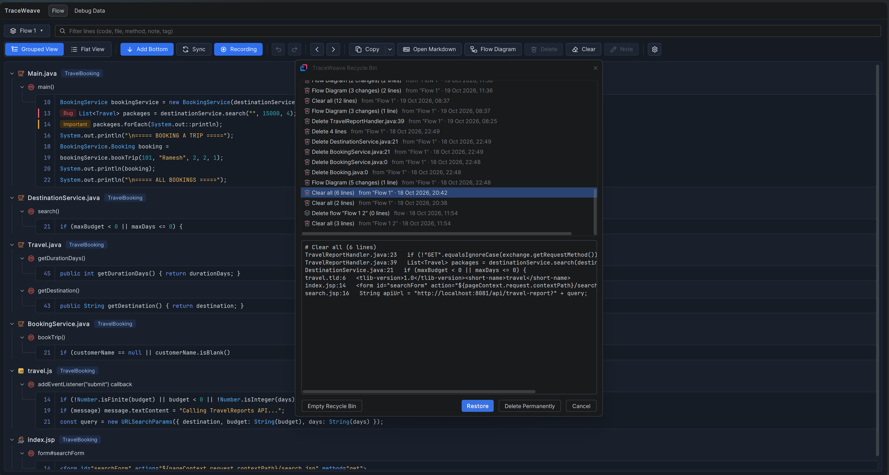

**Record while debugging**

- Click **Record**, then debug as usual. Every line where the debugger stops (a breakpoint or a step) is added at the bottom, in the order it ran. Click **Recording** to stop.
- It also picks up debug sessions that are already running. Recording turns Sync off so the execution order is kept.

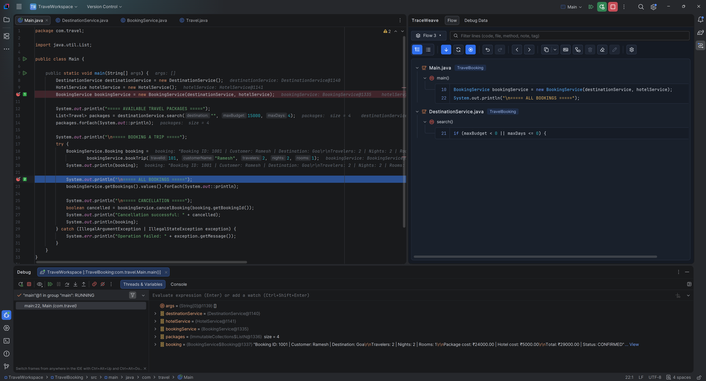

**Debug Data (save, compare and find debug values)**

The **Debug Data** tab of the TraceWeave tool window keeps values from the debugger, so you can compare them between debug runs and find what is hidden deep in objects (for example in the session's attributes).

- **Save a value**: while debugging, right-click a variable in the debugger's **Variables** or **Watches** view, or a result in **Evaluate Expression** (or **Inspect**) → **Save to TraceWeave**. It is saved with its fields, map entries and list elements, 4 levels deep (up to 100 children each), together with where the debugger stopped (file, line, class and method) and the flow that is active. It works with any debugger IntelliJ has: Java, Kotlin, JavaScript and more.
- **From the editor**: while the debugger is paused, select an expression (or put the caret on a variable, e.g. `request.session`) → right-click → **Save “…” to TraceWeave**: it is evaluated where the debugger stopped and saved. **Add Expression…** in the Debug Data tab does the same with an expression you type (e.g. `request.getSession().getAttribute("cart")`); it is enabled while the debugger is paused (otherwise its tooltip says to enable the debugger).
- **Capture Data**: turn it on and debug; the variables of the current stack frame are saved by themselves (as deep as Save to TraceWeave: fields, map entries and list elements, 4 levels), **each variable on its own** (so it can be compared with the same variable saved at that line before), grouped by line. Its **▾** chooses:
  - *When*: **Where the debugger stops** (at breakpoints and at each step you take), or **Every line it runs**: from a stop it steps line by line by itself, saving only what changed on each line, until it reaches the next breakpoint, where it stops as the debugger does (Resume or a step goes on from there). At most 500 lines a debug run.
  - *What*: **All variables of the method**, or **Only the line's variables**: the variables (and fields of `this`) used on the line where it is.
  Click it again (**Capturing…**) to turn it off. A variable isn't saved again at a line where it was already saved with the same data (e.g. by hand before Capture Data was on).
- **Compare**: when the same variable was saved at the same line before (in any flow, in any debug run), the notification says how many values differ and offers **Compare**. In the tab, **Compare** compares the selected value with *its value now* (while the debugger is paused) or with any earlier save of that variable at that line. The Compare window shows the number of changed, added and removed values, and every field side by side with a mark: **~** changed (amber), **+** only on the right (green), **−** only on the left (red); *Only what differs* hides the rest (keeping the rows above each difference, so you see where it is). It compares the data, not the objects: instance ids such as `HotelService@1141` or `{Double@1400}` are ignored, map entries are matched by their key and shown as `"goa" = 2500.0`, and list elements are lined up by their values. **Compare as JSON** opens both values as JSON (keys sorted) in IntelliJ's diff viewer, with added, removed and changed lines; **Copy Differences** copies the list of differences.
- **Two saved values**: select both (Ctrl+click), then **Compare** (or **Ctrl+D**): they are compared with each other, the older one on the left.
- The **Compare window** has the system's **Minimize**, **Maximize** and **Close**, and three views: **Tree** (every field side by side, what differs marked), **JSON** and **Text** (both values in IntelliJ's diff viewer, inside the window).
- **Compare** (or **Ctrl+D**) with one saved value selected opens it on the left (as JSON, or switch it to Text) with the right side empty: paste the other value there (from a log, a teammate, another tool) and press **Ctrl+Enter**: JSON on both sides shows the Compare view (Tree, JSON, Text); other data is compared line by line in IntelliJ's diff viewer, in the same window. Keys in that window: **Ctrl+Enter** Compare, **Ctrl+Shift+V** paste the clipboard, **Ctrl+Shift+X** swap sides, **Alt+1** / **Alt+2** left / right side, **Esc** close. Compare's **▾** compares with its value now or an earlier save instead.
- **Pasted data**: **Compare** with nothing selected lets you paste two pieces of data (JSON, XML / HTML, a `toString()` or the debugger's text such as `Booking{id=4, rooms={ooty=12}}`, or a log) and see what was added, removed or changed. The kind is detected for each side, both are laid out one value per line (JSON keys sorted, instance ids left out), and IntelliJ's diff viewer shows the lines that differ.
- **Find**: the search box finds a name, a map key, a type or a value in all saved values (`cart`, `4711`, or a regular expression such as `/order.*Id/`), with where each match is (`session › attributes › "cart" › total`). Tick **Also in the current debug session** to search the paused stack frame's variables too (read 3 levels deep, marked *now*). Click a match to see it in its value.
- **Tree, JSON or Text**: show the selected value as the debugger's tree, as **JSON** (objects and maps as objects, lists as arrays, numbers and booleans as such, instance ids left out) or as plain indented **Text**. **Copy** copies it as shown; **Export…** saves it as a `.json` or `.txt` file.
- **New Value…** adds a saved value by hand: a name and its data (JSON becomes fields; other text is kept as the value), e.g. the expected data to compare a debug value with.
- **Edit in the Compare window**: in **Tree**, double-click a value in the Old or New column to change it; in **JSON** and **Text**, edit or paste on either side (the changed / added / removed counts follow as you type, marked *not saved yet*) and click **Save Edits** (Ctrl+S). Changes to saved values are saved (and are in their History in Debug Data); the comparison is redone at once. **Undo** (Ctrl+Z), **Redo** (Ctrl+Shift+Z), **History** and **Reset** (both sides back to the data as saved) work in the window. After a change, **See what changed** shows that side before and after. **History** lists the steps taken in the window (**Go To** one) and each saved value's own changes from Debug Data (**Revert** one); **Show Changes** shows what any of them did.
- The Compare window says which side is **Old** and which is **New** (bright **OLD** / **NEW** labels over the sides, and in the JSON and Text views' titles); **⇄ Swap Old / New** (Ctrl+Shift+X) makes the other side the new data (what was added then shows as removed, and so on).
- **Open File…** (Compare window) puts a `.json` file, or one value of a `.flowdebug.json` export, on the Old or the New side. **Export…** saves the Old data, the New data (as JSON), the differences (as text), or all three. Both open their menu above the button.
- **Compare Pasted Data** (Compare with nothing selected): paste or **Open File…** on each side, then **Compare** (Ctrl+Enter). The result shows **in the same window**: the Compare view for JSON on both sides, IntelliJ's line-by-line diff for anything else. **Back to Edit** (Esc in the diff) returns to the two sides, with your text still there to change and compare again.
- **Add Field** on an object lists its class's fields from the code: its **own** fields first, then the ones it **inherits** (marked with the parent class they come from, and the ones already saved marked too). Pick one (its type comes along) or type any name; a field (or map key) that is already there can't be added twice: edit it instead. Values added by hand get types like the debugger's: a new map entry takes the types of the map's other entries (e.g. `Integer`), other values a type from what they hold (`String`, `Integer`, `Double`, `Boolean`, `Object`, `List`).
- **Edit as JSON or text**: in the **JSON** or **Text** view, just type (or click **Edit**), then **Apply** (Ctrl+Enter; Esc cancels). Maps stay maps (entries matched by key, new keys become entries), and what you didn't change keeps exactly what the debugger showed (types, ids). **Reset** goes back to the data as it was saved. Each Apply and Reset is in **History**, where **Revert** undoes it.
- **Maps, lists and objects**: editing a map entry changes its **key** and **value** (the entry follows, also in JSON, search and Compare); **Add Field** on a map adds an entry (key and value), on a list an element, on an object a field. A value written as JSON (`{"city": "Goa", "rooms": 3}` or `[1, 2]`) becomes a whole object or list with its fields.
- **Add, edit, remove, copy fields**: **Add Field** (Insert) adds a field under the selected one, **Edit** (F2, or double-click) changes a field's name or value, **Remove Field** (Delete) removes it. Right-click a field to **Copy Value** (Ctrl+C), **Copy “name = value”**, **Copy as JSON** (the field with its name) or **Copy Children as JSON** (only what is inside it), and **Paste** (Ctrl+V): pasted JSON adds its fields (or entries, or list elements) to the selected field and updates the ones it has, so a field copied as JSON and pasted on its parent updates it; plain text becomes a simple field's value. Select several fields (Ctrl+click / Shift+click) to copy or remove them together; Ctrl+C on the list copies the selected saved values as JSON, and several saved values (also search results) can be deleted at once. What is open in the tree stays open while you edit. Every change is kept in **History**, where **Revert** undoes it (an added field goes, a removed one comes back).
- **Edit**: double-click a field (or **Edit**) to change a saved value, e.g. to note what it should have been. Edited values are marked ✎; **History** lists every change (old → new, when) and **Revert** puts a value back (as a new change, so the history stays complete).
- **Import / Export**: **Export…** saves the selected values (or all of them) with their fields and edit history to a `.flowdebug.json` file, e.g. to attach to a bug report or to compare on another machine; **Import…** adds the values of such a file to yours (nothing is replaced; importing a file twice keeps both). **Save As…** next to a value saves just that value as `.json` or `.txt`.
- **Flows**: the **Flow ▾** button left of the search shows the flow new values go to. It opens the same **Flows** popup as the Flow tab (click a flow to switch, drag to reorder) with **New Flow…**, **Rename Flow…**, **Delete Flow…**, **Delete Flows…**, **Export the Flow's Values…** and **Import Values into the Flow…**. The list groups the values by flow, then by line; every flow is listed, also an empty one.
- **Right-click the list** for the flow's actions (**Rename Flow…** (F2), **New Values Go Here**, **Move Up / Down**, export, import, **Delete Flow…**, **New Flow…**), for a line's **Name This Line…** / **Clear Line Name**, and **Copy Values as JSON**. A line's name (e.g. *before payment*) shows after its file, line number and method, so lines are easy to tell apart.
- **Selecting a flow** (or one of its lines or values) in the list selects it in the Flow tab too. **Renaming** a flow here renames it in Debug Data only; the Flow tab keeps its name (and the other way round).
- **Settings** (the gear at the end of the toolbar) holds **Layout** (the list and the value **side by side**, **top and bottom**, or *Auto*: above each other when the tool window is narrow, so the value is never squeezed out) and Capture Data's *When* and *What*.
- The tab looks like the Flow tab (its panel background, the list and the value on rounded cards, the same buttons, and **Use IntelliJ Theme** applies to it too). Its buttons wrap and get shorter (icons only) when the tool window is narrow.
- **Delete** removes the field selected on the right when you clicked there last (History → Revert puts it back). With values or lines selected on the left, it moves them to the Recycle Bin. With **flows** selected, it deletes the flows (here and in the Flow tab): at once when they have nothing in either screen, else after one confirmation that says what goes (Debug Data's values first, then the Flow tab's lines).
- Keys (they work wherever the focus is in the tab, before the IDE's own shortcuts): **Delete** deletes (in the Recycle Bin: for good), **Ctrl+C** copies the selected values (on a field: its value), **Ctrl+V** pastes into a field, **Insert** adds a field, **F2** renames a flow or line in the list, or edits a field, **Ctrl+D** Compare, **Ctrl+F** Find.
- **Delete** moves saved values to the tab's **Recycle Bin** (**← Back to Saved Values** leaves it): **Restore** brings them back, **Delete Permanently** removes them (the bin keeps the latest 200).
- Saved values are kept per project in `.idea/workspace.xml`, grouped by flow and by line.

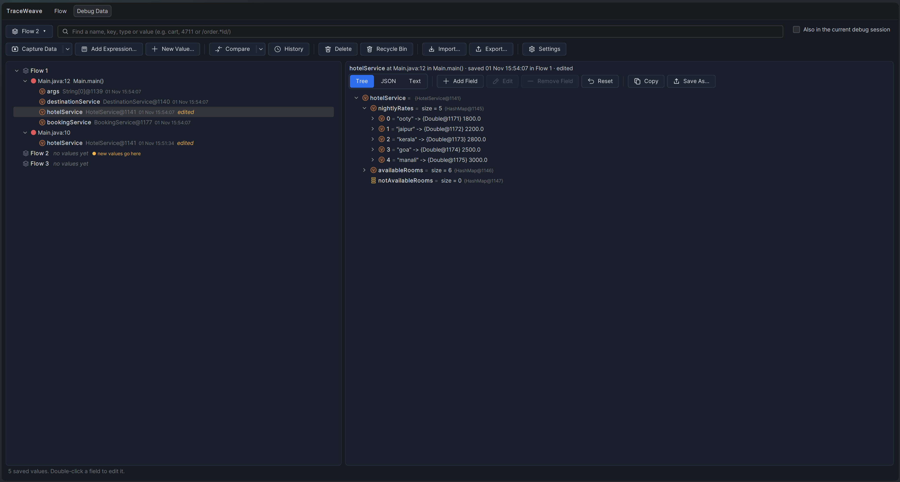

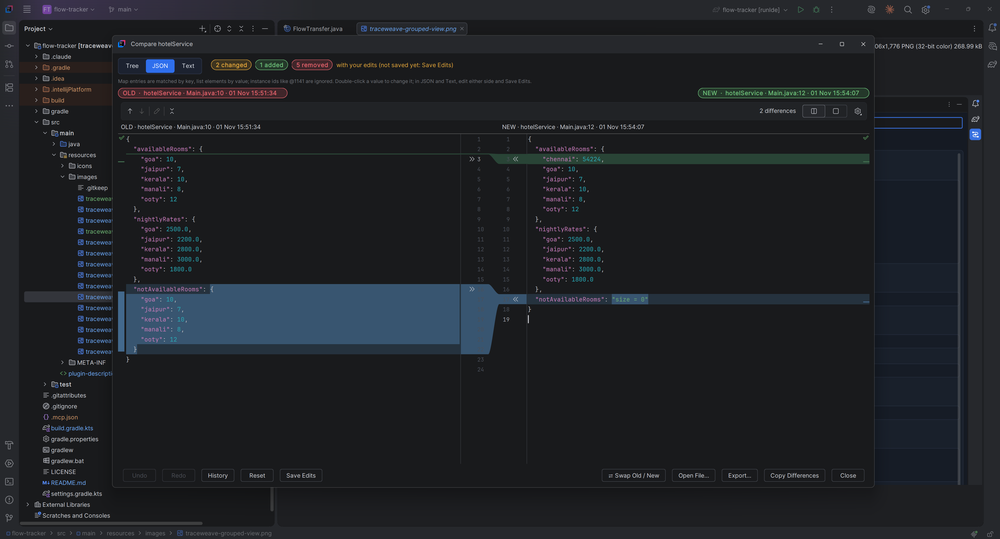

**Flows (and sharing them)**

- Each project can hold as many flows as you like. The flow button at the top left (for example `Flow 1: Checkout bug ▾`) opens the **Flows** popup: click a flow to show it. The current flow is checked, and every flow shows its line count.
- **Reorder**: drag a flow by its handle (⠿), or select it and press `Ctrl+Up` / `Ctrl+Down`. **Copy All Flows** copies the flows in this order.
- **New Flow…** and **Rename Flow…** start the name as `Flow 1: ` (with the flow's number) and put the cursor after it, so you only type the name, e.g. `Flow 1: Checkout bug`. You can delete the prefix if you don't want it. Leaving just the prefix keeps the plain `Flow 1`.
- **Delete Flow** moves the flow to the Recycle Bin, so it can be restored. Deleting the only flow empties it instead. **Delete Flows…** lists every flow with a checkbox (and what it has: `5 lines · 2 saved values`) to delete several, or all, at once.
- **The Flow tab and Debug Data share their flows**: a flow made in one is in the other, and the flow selected in one is selected in the other. Deleting a flow deletes it in both: a flow with nothing in either (no lines, no saved values) goes at once; when either has data, one confirmation says what goes, first in the screen you are in, then in the other one (lines and values go to their Recycle Bins). **Names are not shared**: renaming a flow in one doesn't rename it in the other.
- **Export Flow…** saves the current flow as a `.flow.json` file. Paths are stored relative to the project folder, so you can commit the file or send it to a teammate.
- **Exported files start with the project's name** in camelCase, e.g. `travelBooking_Flow 1.flow.json`; a flow with lines from several projects gets all of them (`carSearch_hotelBooking_…`). The same goes for Debug Data and Compare exports.
- **Import Flow…** opens a `.flow.json` file as a new flow. Files are found by relative path first, then by file name. Lines whose file isn't in the project are marked *file missing*.
- Undo / Redo history belongs to the flow it was made in and starts empty when you switch.

**Search**

- The search box above the toolbar shows only lines whose code, file, class, method, note, project or tag contains the text (or whose line number matches).
- While a filter is on, **Copy** copies only the matching lines. Moving lines still works: hidden lines keep their places.
- **Copy ▾** → **Copy Original Log** copies only the Original Log (the plain text the Markdown copy ends with: each call nested under the line that makes it, or the plain list of the view), without the Markdown around it.

**Views**

- **Grouped View**: file → method → lines, with a project tag on every file.
- **Flat View**: one numbered sequence in flow order.

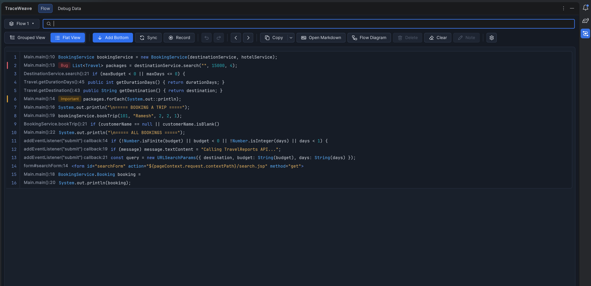

**Rows**

- Hover a row for its action bar: `↑ ↓ | Copy Note | Delete`. Arrows appear only when the row can move, and Note only on code lines.
- Drag to reorder. Right-click for Move, Copy, Note, Jump to Source, Walk from Here, Connect Call To, Tag and Delete. Double-click a line to open it.
- `Ctrl+C` copies the selection, `Delete` removes it.
- **Connect calls by hand**: some calls can't be followed from the code, e.g. a REST / API request that is handled by a controller in another project. Right-click the calling line → **Connect Call To** → pick the method it reaches (the flow's other methods are listed; connected ones are checked, and picking one again removes it). The row shows `→ create()`, and the connection counts like a real call everywhere: Sync order, the Markdown diagrams and the nested Original Log. Connections are saved with the flow and included in **Export / Import**. **Remove Connections from This Line** clears them.
- **Connect the Flow Between These Lines**: select two lines (Ctrl+click), e.g. a line of `main()` and a line of `Travel.getDestination()`, then right-click → **Connect the Flow Between These Lines**. TraceWeave reads the code and adds the lines in between, right after the first one: the calls that lead from one to the other (`bookingService.bookTrip(…)` in `main()`, then both lines of `bookTrip()` that call `getDestination()`). It follows what the first line works with (the variables it makes or uses, and what they are passed to), so of several ways it takes the one that carries that data; it looks only at the code from the first line on. The lines go in as one step that **Undo** takes back. It needs the project's code to resolve (a loaded Gradle / Maven project; red code can't be followed).
- **Tags**: right-click → **Tag** → 🐞 Bug, ⭐ Important or ❓ Question (or No Tag). A tagged line shows a coloured bar at its start and its tag right after the line number, before the code, so it can be seen without scrolling a long line. Tags are included in every copy format, and can be set in the Flow Diagram too (right-click a method → **Tag**).
- **Out-of-date lines**: when a saved line no longer matches the code, it gets an orange warning: *file missing*, *moved to line N* or *code changed*. Hover it for details. Right-click → **Re-link to Code** follows moved code, or takes the line's current code. **Re-link All Moved Lines** fixes every moved line at once.

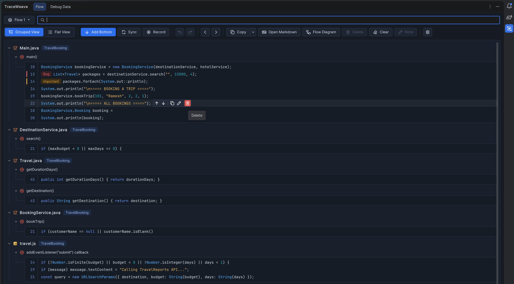

**Flow Diagram (draw and edit the flow)**

- **Flow Diagram** (toolbar, next to **Open Markdown**) opens the flow as a diagram (one window per project; it opens right away with the calls the panel has found). It is a normal window that doesn't block the IDE: it has the system's **Minimize**, **Maximize** and **Close** buttons (Close asks before dropping changes that aren't saved), and **Flow Diagram** in the TraceWeave window brings it back when it is minimized or behind other windows: a box per class or file with its methods (and how many lines each has), solid arrows for calls found in the code and dashed arrows only for calls connected by hand. Each box shows its file and the project it belongs to (`BookingService.java · TravelBooking`), in the diagram and in the sequence diagram. A selected call is highlighted with a glow.

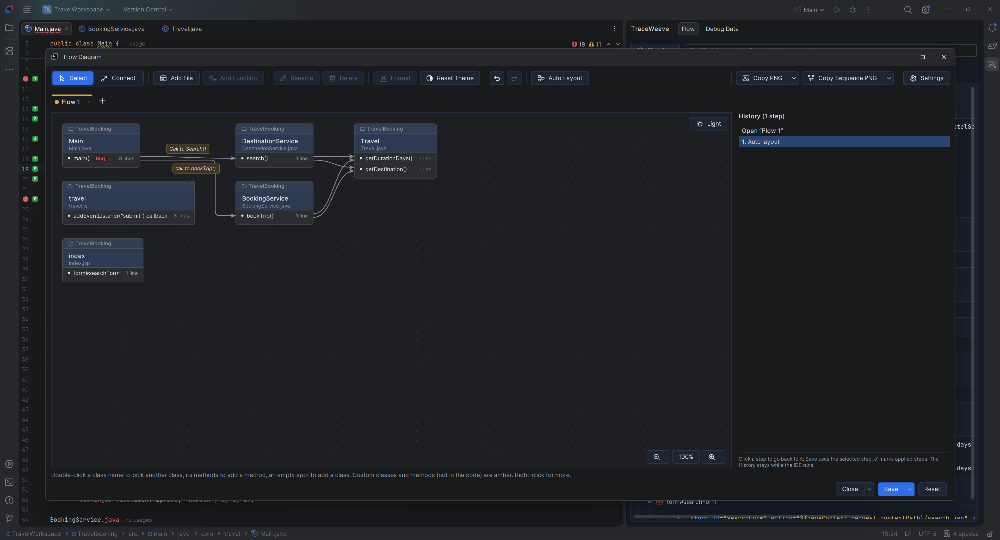

*Toolbar*, from left to right:

| Button | What it does |
|---|---|
| **Select** / **Connect** | Select moves boxes and selects classes, methods and calls. Connect draws a call: drag from a method to the method it calls. |
| **Add File** | Adds a file from the project (Java, JSP, a script, a TLD…), then one of its classes; a file that isn't in the project becomes a custom class (see below). |
| **Add Function** | Adds a method of the selected class, or a function or block of the selected file, and the lines you pick from its code; a name it doesn't have becomes a custom method. |
| **Rename** (`F2`), **Delete** (`Delete`) | Rename or remove the selected class, method or call. |
| **Format**, **Reset Theme** | Colors, text formats, notes and line styles (see below); Reset Theme gives everything the default look again. |
| **Undo**, **Redo** (`Ctrl+Z` / `Ctrl+Y`) | Step through the History. |
| **Auto Layout** | Arranges the classes in call order: every call goes from left to right (a class called directly and through another one is placed after that other one), with room between the boxes for the calls' notes. |
| **Copy PNG ▾**, **Copy Sequence PNG ▾**, **Settings** | At the right end: copy images, and the window's background settings. |

The toolbar belongs to the selected tab and sits above the tabs.

*Tabs (one tab = one flow)*

- Each tab shows one flow, like a browser's tabs: the selected one is joined to its page, with a bar of the tab's color on top. **+** after the last tab opens **New Flow** or one of the saved flows that isn't open yet. A new tab's flow is only kept when it gets something: closed (or the window closed) while empty, it is gone.
- **Right-click a tab** for **Rename Flow…**, **Tab Color…**, **Connect With** (another tab, shown combined in a new tab), **Close Tab** and **Delete Flow…**.
- **✕** on a tab closes it: at once when it is empty or saved; with changes that aren't saved it asks **Save and Close**, **Don't Save**, **Move to Another Tab…** (its classes go to another tab) or **Cancel**.
- Closing the Flow Diagram window deletes every flow that is still empty (one flow always stays).

*Several classes: select, copy, move to another tab*

- **Ctrl+click** classes to select several (they get a dashed outline); **Ctrl+A** selects all. **Ctrl+C** / **Ctrl+X** / **Ctrl+V** copy, cut and paste them, also into another tab; **Delete** removes them.
- Right-click → **Copy to Tab** / **Move to Tab** → an open tab, or **New Tab…** (a new flow named after the classes, laid out at once). Classes keep their look, tags and notes, and the calls between them; they don't show "added" or "(+1)" in their new tab.
- **Link boxes**: where a moved class calls (or is called by) a class that stays, both tabs show the other side as a **link box**: the real class (click its methods to see their code), with `⇄ in “the other tab”` under its name and an orange frame. In the tab the class left, it takes the class's place; in the new tab, callers stand on the left and the classes it calls on the right, each class in its own link box. The calls keep their notes and styles.
- Moving classes also opens a tab with **both tabs combined**: the classes back in their places, connected where the code really makes the calls (each call is checked in the code, not drawn because of the names), laid out left to right.

*Connect the Flow to… (the code between two methods)*

- Right-click a method → **Connect the Flow to…** → pick another method of the diagram. TraceWeave reads the code and adds what leads from one to the other: for `Main.main()` to `Travel.getDestination()`, the `bookingService.bookTrip(…)` line in `main()`, a **BookingService** box with the two lines of `bookTrip()` that call `getDestination()` (lines 33 and 41), and the calls between them, laid out left to right. Each line is the one the call is on (a call written over two lines adds its second line).
- It looks at the whole first method and follows what its flow lines work with (e.g. `bookingService`), so another call that also gets there (e.g. `destinationService.search(…)`) isn't taken instead. A balloon says what was found; **Save** adds the new lines to the flow.
- It needs the project's code to resolve: when IntelliJ can't (the Gradle / Maven project isn't loaded, or the code is red), it says so.

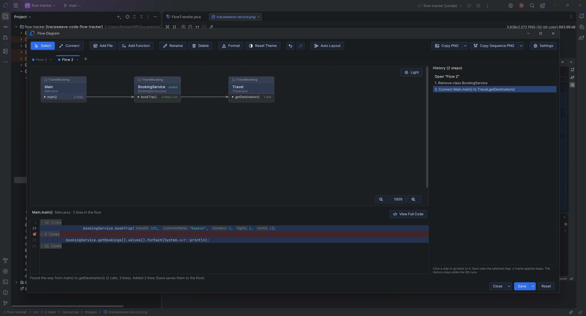

*Adding classes and methods*

- **Add File** asks for a **file**: type at least **3 letters** of its name (a class name finds its file too) and the matching files are listed as you type, with their folder and project. Use `*` and `?` as wildcards for the whole name (`*Cruise*.java` finds `OdysseyCruiseProcessor.java`), or a regular expression between slashes: `/Book.*Service/`. When the file has several classes, the next window lists them to pick one (the one named like the file is preselected).
- **Custom classes**: a file name that isn't in the project is offered as a custom class named after it: `PaymentGateway.java` adds the class `PaymentGateway` in the file `PaymentGateway.java`. Right-click it to **Rename Class…** or **File and Project…** (its file name and the project it is meant for, shown in its box) later, or double-click its name to pick a class of the project instead.
- **Add Function** lists the methods of a class from the code, or a file's functions and blocks (scriptlets, tags, elements), filtered as you type with the same search (`get*`, `*Booking`, `/^(get|set)/`), from the first letter. Pick one, and a second window shows **its code** so you can tick the lines to add. Without ticking any, the method's first line is added so the method is in the flow. A name the class doesn't have is offered as a **custom method** (the last row); for a custom class, Add Method asks for the name.
- Custom classes and methods (not in the code) and the arrows to and from them are drawn in **amber** (marked *custom*). Code lines can only be picked for classes from the code.
- **Tags**: right-click a method → **Tag** → Bug, Important or Question (or No Tag). The tag shows next to the method's name, and on Save every line of the method gets it in the TraceWeave window.
- **Double-click** a class **name** to pick another class of the project for that box (its methods stay, as custom methods of the new class), its **methods** to add a method, or an empty spot to add a class there.
- **Project**: a class's project is shown in a band joined on top of its box, in the box's own colors, border and file-name format, with a folder mark (custom classes get one with **File and Project…**). **Format** the class to give the band its own **background**, **border** and **text** (bold, italic, underline, color); Reset Theme takes them back. The sequence diagram (Copy Sequence PNG) shows the same band on top of each participant.
- **Rename a class**: the project's classes that match the new name (also with wildcards or a `/regex/`) are listed as you type; pick one and it takes the box's place. A name no class has makes it a **custom class**. Renaming a method changes its name in TraceWeave only.
- Right-click a class, a method, a call or an empty spot for the same actions.
- **Notes on calls**: select a call and click **Format** (or right-click it → **Format Line…**) to write a note on it, e.g. `REST: POST /bookings` (press Enter for several lines). Give it a **shape** (rounded, rectangle, pill, or text only: the arrow stops on both sides of the text instead of running through it) and its own **background**, **text** and **border** colors (Auto: the usual ones, with text that stays readable). It is shown on the arrow (click it to select the call): at the middle, or at the first free spot along the arrow when another note or a box is there, so notes never cover each other; and on the call's arrow in the sequence diagram (and in Copy Sequence PNG). It is saved with the flow; Reset Theme gives notes the usual look and keeps their text.


*Moving around*

- **Drag a box** to move it. Boxes never cover each other: when a box grows (a longer name, a note, more methods) or is dropped on another, the boxes around it move right or down to make room, and the box you just edited or moved stays put.
- **Lines go around boxes**: a call whose line would run under another box takes a detour through the gaps between the boxes (rounded corners for curved lines, right angles for the others).
- **Drag an empty spot** (or drag with the middle mouse button anywhere) to move the view.
- **Zoom**: the **−**, **100%** and **+** buttons in the bottom right corner zoom out, back to 100% and in (25%–300%). `Ctrl` + mouse wheel zooms around the mouse; `Ctrl+Plus`, `Ctrl+Minus` and `Ctrl+0` work too.
- The **Dark / Light** switch in the top right corner flips the drawing area's background.

*Code panel*

- Click a method and the **code panel** opens under the diagram (it closes when no method is selected). It shows the method's lines in the flow in a read-only editor with the IDE's syntax colors and the file's real line numbers; the flow's lines are highlighted and the rest of the file is folded into `⋯ n lines` (click one to open it).
- **View Full Code** shows the whole file at that method, with the flow's lines still highlighted; **Flow Lines Only** goes back. Drag the divider to give the code more room. The method's first line is brought into view near the top.
- Hover a line number: **+** adds that line to the method (Save puts it in the flow), **−** on a flow line takes it out. A line can't be taken out while it makes a call that is drawn to another box, or when it is the last line of a method connected to other boxes: a warning under the code says why.
- **Double-click** a line to open it in IntelliJ's editor. **Ctrl+click** a method, field or class name to show its code here; **Back** returns.

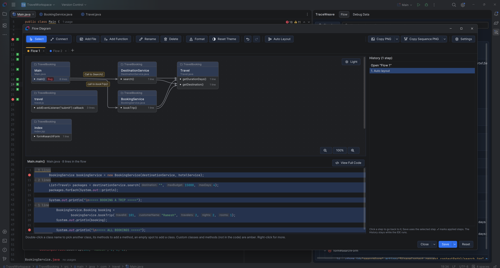

*History, Save, Reset and Close*

- Every change is listed on the right. **Undo** / **Redo**, or click a step to go back to it. The History stays after **Save** and when the window is opened again (while the IDE runs); saved steps are marked ✔. Clicking a step from before an earlier Save and saving it brings the flow back to that state. A change that leaves the diagram as it is (for example **Auto Layout** clicked again) isn't added.
- The buttons at the bottom right are **Close · Save · Reset**. Close and Save are split buttons: their **▾** opens a menu above the button.

  | Button | Click | ▾ |
  |---|---|---|
  | **Close** | Closes this tab (asks first when it has changes that aren't saved) | **Close All** (each tab with changes asks), **Don't Save and Close All**, **Save and Close All** (every tab is saved, then the window closes) |
  | **Save** | Saves this tab to its flow (after asking); the tab stays open | **Save All**: every tab with changes, without asking each one |
  | **Reset** | Drops the changes made since the last Save (after asking); the tab stays open | |

- **Save** writes the changes to the flow as **one** step (the TraceWeave window's **Undo** reverts it); **Reset** keeps the flow, and the History, as they were:

  | In the diagram | In the TraceWeave window |
  |---|---|
  | Add File, Add Function with picked lines | Those code lines, as saved lines |
  | A custom class or method (a file or name not in the project) | A line marked **+** with `// added in Flow Diagram` (no code yet), in the custom class's file name |
  | Tag a method | Every line of the method gets the tag |
  | Rename a class or method | Its lines get the new name (in TraceWeave only; your code doesn't change) |
  | Delete a class or method | Its lines go to the Recycle Bin |
  | Draw a call | A **Connect Call To** connection (calls found in the code can't be removed) |
  | Format, notes (on boxes, methods and calls), box positions | Saved with the flow (and in **Export / Import**) |

- Lines added in the diagram work everywhere else too: Sync, the Markdown diagrams, the Original Log and Export / Import. The Markdown copy says what isn't in the code yet (*not in the code yet: … added in the Flow Diagram*, and *No code yet* in the line table); the walk-through says so too.

*Format*

**Format** (toolbar, or right-click → **Format Box (and Note)…** / **Format Method (and Note)…** / **Format Line…**) changes how the selection looks and holds its note. Formats, notes and box positions are saved with the flow when you **Save**, so they come back after a restart; the toolbar's **Undo** reverts them, and **Export / Import** carries them in the `.flow.json` file.

- **A box** (class or file): a **theme**: **Plain** (the default, the diagram's own look), **Light**, **Dark**, or Blue, Green, Amber, Rose, Purple, Teal, Navy, Slate, each with a strong class section, a softer method section and a matching border. Or set its own colors for the **class section** (name, file name, note), the **method section** and the **border**: set one section and the other follows in a matching shade until you set it too. Text turns dark or light by itself so it stays readable on any background (**Auto**). A live preview shows the box while you pick.
- **Text** (class name, file name, method names, notes): **B**old, *I*talic, **U**nderline, **S**trike-through and a color. The B / I / U / S buttons are filled with the accent color while they are on. A box's *Method names* format applies to all its methods; a method's own format (Format Method) wins.
- **Colors**: each color is one button (its swatch and name, ▾). It opens a picker with **Auto**, suggested colors, ten color families in six shades plus greys, your recent colors, a `#RRGGBB` field and **More colors…** (IntelliJ's color chooser); the current color is marked.
- **Notes**: shown right under the class name or the method name. They can have several lines (long ones wrap) and their own text format. Drag the handle under the note box to make it taller or shorter.
- **A call's line** (and its **note**): its **pattern** (automatic, solid, dashed, short dashes, long dashes, dotted, dash-dot, dash-dot-dot, double line, double dashed), **width** (thin to heavy), **shape** (curved, straight, elbow), **arrow** (sharp arrow, triangle, open arrow, diamond, dot, none) and **color**, each shown as a picture, with a live preview. *Use this line for every call in the diagram* styles all lines at once.
- **Reset**: the Format Box, Format Method and Line windows have a **Reset** button (bottom left) that puts every option back to the default (the Plain theme, usual text formats, the usual line) before you press OK; the note text stays. **Reset Theme** in the toolbar does the same for every class, method and line at once, as one step you can undo; notes, calls and positions stay.

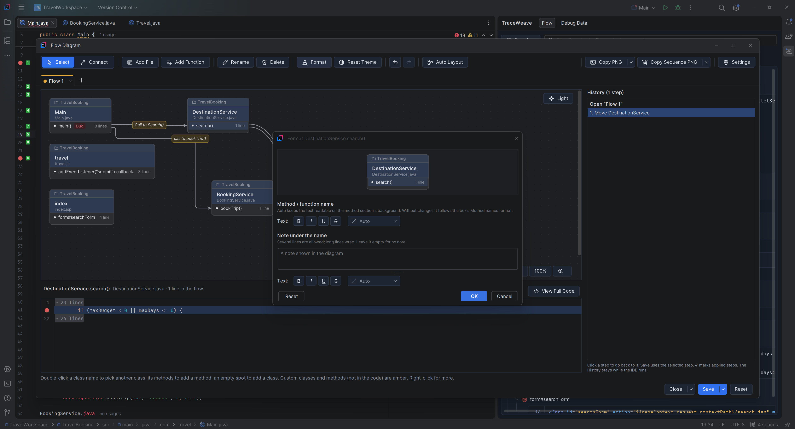

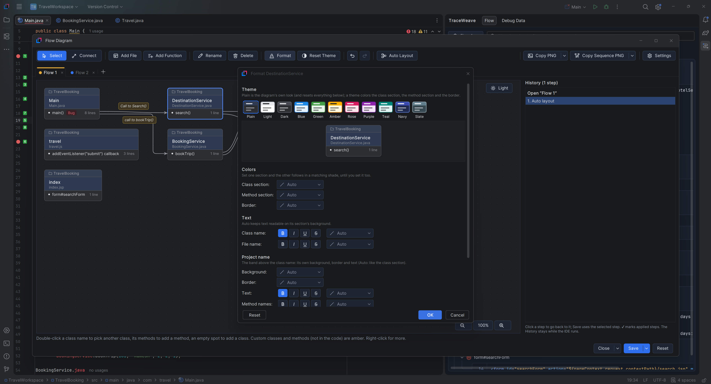

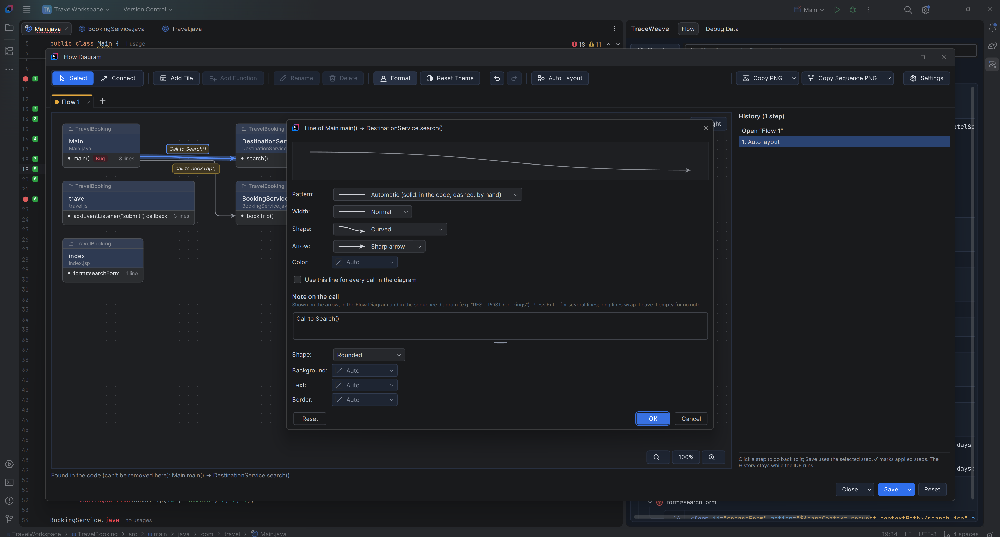

*Images and settings*

- **Copy PNG** copies the diagram as an image; **Copy Sequence PNG** copies its calls as a numbered sequence diagram image (participants, calls and returns). They paste into documents, chats and image editors, always at full size whatever the zoom. Each is a split button: click it for the default background, or its **▾** for **Copy with Light Background** / **Copy with Dark Background**.
- **Settings** (the gear at the right end) sets the **default background of the copied images** (light or dark) and the **diagram window's background** (same as TraceWeave / the IntelliJ theme, light or dark). Its popup opens below the button, lined up with its right edge. Both settings are remembered for all projects.

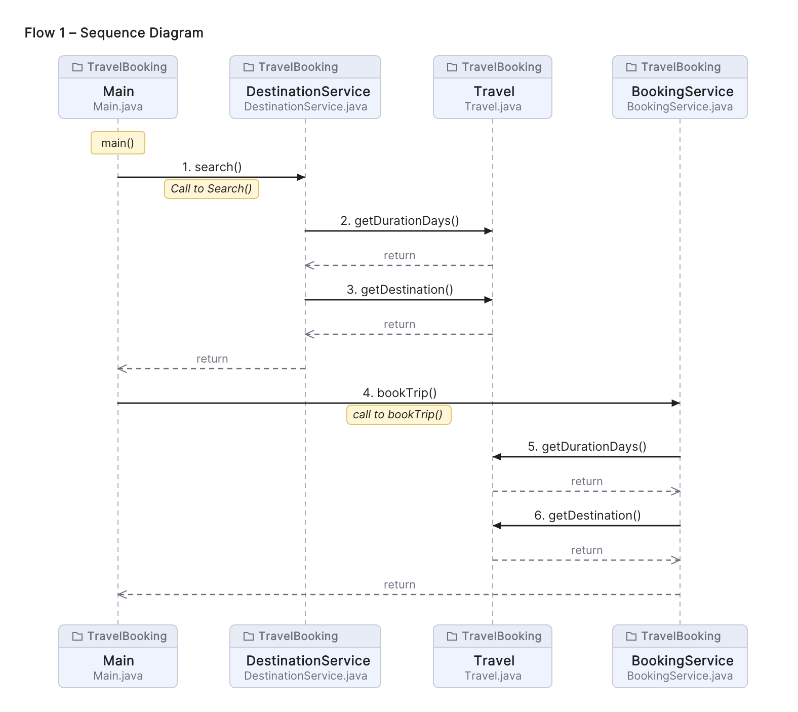

**Walk-through**

- **Next Step** / **Previous Step** (toolbar arrows, or `Alt+]` / `Alt+[` anywhere in the IDE) open each saved line in the editor in the order the panel shows them. A hint shows the step number, the method, the tag and the note.
- Select a line, or right-click → **Walk from Here**, to continue from it. The actions are also under **Tools → TraceWeave**, and you can rebind the shortcuts in **Settings → Keymap**.

**Sync (call order)**

- With **Sync** on, a method comes first and the methods it calls follow right after the calling line, across files.
- Moving anything by hand turns Sync off. Click **Sync** again to re-sort.

**Settings (⚙️)**

| Option | What it does | Default |
|---|---|---|
| Sync Files | Automatic call order | On |
| Optimize Flat View Log | Flat View copy as a compact `[project]` / file / method log with `line \| code` rows | Off |
| Copy as Markdown | Copy as a `.md` document: summary table, Mermaid diagrams of the real calls, each method's lines as a table with syntax-highlighted code, and the **Original Log** at the end (see below) | On |
| Sequence Diagram | In the Markdown copy, draw the calls as a Mermaid `sequenceDiagram` (files calling each other, with returns) instead of a `flowchart`. It follows the real calls from each entry method, whatever order the lines are listed in | On |
| Copy All Flows | When on, the toolbar's **Copy** button copies every flow, one after the other under its name, in the Flows popup's order and the copy format chosen above. `Ctrl+C` still copies the selected lines | On |
| Nest Calls in Original Log | In the Markdown copy's Original Log, each called method's lines go right under the line that calls it, indented like a call stack (see below) | On |
| Use IntelliJ Theme | Take every TraceWeave color from the current IntelliJ theme and editor color scheme: the panel, buttons, popups, highlighted code and the Flow Diagram. Off: TraceWeave's own colors (light and dark). Applies to all projects | Off |
| Recycle Bin | Restore or permanently delete deleted lines and flows | |
| Info | Help dialog with all features, with a carousel of screenshots at the top | |

*Optimize Flat View Log* and *Copy as Markdown* exclude each other.

**Open Markdown** (the toolbar button next to **Copy**) opens the flow as a Markdown document in the editor, so the preview shows the diagrams right away: always as Markdown, whatever the copy setting, and all flows when *Copy All Flows* is on. The document is a scratch file (**Project view → Scratches and Consoles**), so you can keep it, edit it or save it elsewhere.

In the Markdown copy, each method's lines are a table with the line number in its own column, the code (syntax highlighted), and a Note column (tag and note) when any line has one:

| Line | Code | Note |
|---:|---|---|
| 21 | <code><span style="color:#3574F0;font-weight:600">if</span> (customerName == <span style="color:#3574F0;font-weight:600">null</span> &#124;&#124; customerName.isBlank()</code> | 🐞 Bug · _Storing the Data_ |
| 27 | <code><span style="color:#3574F0;font-weight:600">if</span> (nights &gt;= travel.getDurationDays()) {</code> |  |

The code is colored with the same rules as the panel (keywords, types, strings, numbers, comments; tags and attribute values in markup) using inline HTML colors. IntelliJ's Markdown preview, VS Code and most editors show the colors; GitHub removes inline colors and shows the same table with plain code.

In the Markdown diagrams, each box or column is titled with the project on top (`📦 TravelBooking`, like the project band in the Flow Diagram), then the file name and extension (for example `BookingService.java`, `travel.js`, `travel.tld`); the flowchart adds the method under it. Code that doesn't call between groups (for example a Java service, a script and a tag library) gets one diagram per group; a JSP page that calls Java methods is in the same diagram as them. Lines outside methods (fields, imports) are left out of the diagrams but stay in the details.

Each flow's Markdown ends with an **Original Log** section: the lines as plain text in a text block. With **Copy All Flows** on, every flow ends with its own Original Log.

With **Nest Calls in Original Log** on (the default), each called method's lines sit right under the line that calls it, indented like a call stack. Code lines sit one tab (4 spaces) under their method, at every level, and an empty line closes each called block. A called method in the same file as its caller shows just its method name (no file line); one in another file shows the file name, and the project only when it differs from the calling file's project (so a call into another project, e.g. an API, stands out). Grouped View:

```text
Main.java  (TravelBooking)
main()
    8: DestinationService destinationService = new DestinationService();
    13: List<Travel> packages = destinationService.search("", 15000, 4);
        DestinationService.java
        search()
            21: if (maxBudget < 0 || maxDays <= 0) {

    14: packages.forEach(System.out::println);
    26: boolean cancelled = bookingService.cancelBooking(booking.getBookingId());
        BookingService.java
        cancelBooking()
            55: Booking booking = bookings.get(bookingId);

    27: System.out.println("Cancellation successful: " + cancelled);
```

Flat View gives the same nesting as numbered steps:

```text
1. Main.main():8 | DestinationService destinationService = new DestinationService();
2. Main.main():13 | List<Travel> packages = destinationService.search("", 15000, 4);
    3. DestinationService.search():21 | if (maxBudget < 0 || maxDays <= 0) {

4. Main.main():14 | packages.forEach(System.out::println);
```

A call from a line you didn't save goes under the saved line before it. A method called from several places is shown at its first call; the other calls point to it (`↳ search()  (DestinationService.java, shown above)` or `(see step 3)`).

With the switch off, the Original Log is the plain copy of the current view: the file → method → lines list (Grouped) or the numbered steps (Flat), exactly what **Copy** gives with *Copy as Markdown* off.

A Markdown copy with the sequence diagram, rendered in IntelliJ's Markdown preview:

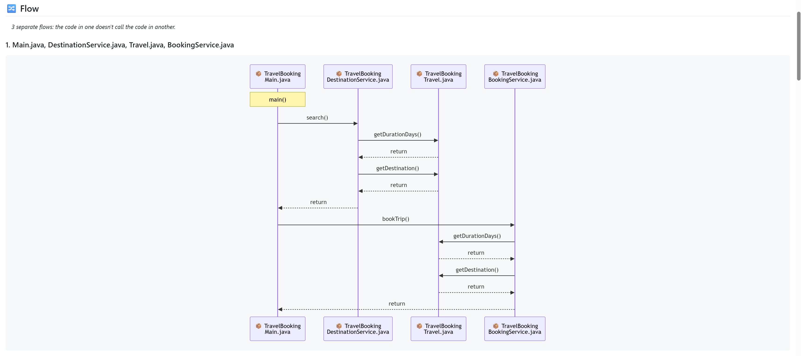

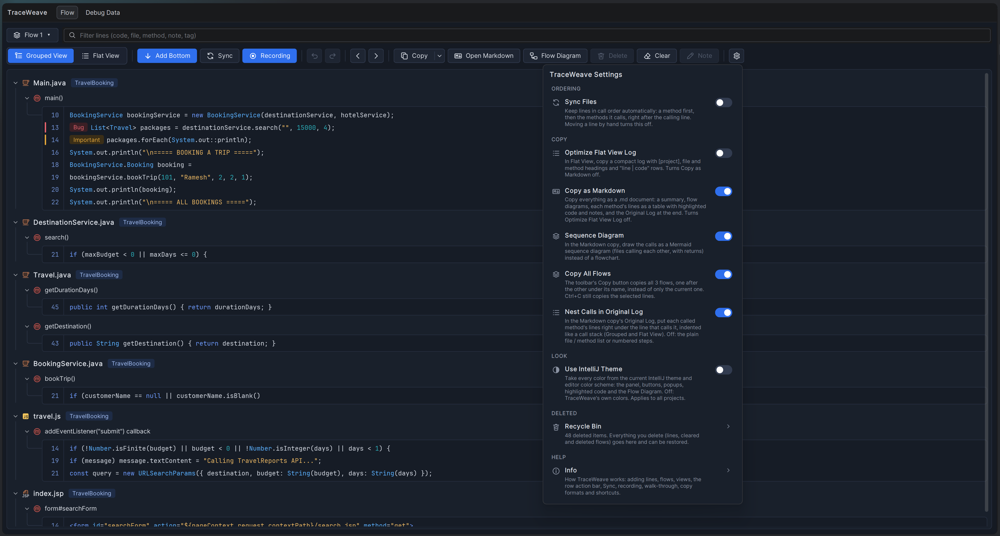

Flows, settings and the Recycle Bin are saved per project in `.idea/workspace.xml`. Lines saved by version 1.0.0 open as **Flow 1**. The same help is in the plugin under **Settings ⚙️ → Info**.


## Screenshots


The image carousel at the top of a plugin's page in **Settings → Plugins** comes from **JetBrains Marketplace**: it shows the screenshots uploaded on the plugin's Marketplace page (**Edit plugin → Media**). It can't be set in `plugin.xml`, and a plugin installed from disk shows no carousel. To get one:

1. Publish the plugin on [JetBrains Marketplace](https://plugins.jetbrains.com) (see [Publish to JetBrains Marketplace](#publish-to-jetbrains-marketplace)).
2. On the plugin's Marketplace page, open **Edit → Media** and upload the screenshots (PNG or JPG; JetBrains recommends 1280×800). Their order there is the carousel order.
3. The IDE shows the carousel for everyone who views the plugin in **Settings → Plugins → Marketplace**.

**Plugin icon.** The icon in **Settings → Plugins** is `src/main/resources/META-INF/pluginIcon.svg` (40×40) and `pluginIcon_dark.svg` for dark themes. IntelliJ shows a generic plug icon when they're missing.

**Images in the Overview tab.** The text on the plugin's **Overview** tab comes from `src/main/plugin-description.html` (Gradle puts it into `plugin.xml`). It has a spot for each screenshot, but the IDE only shows description images from a web address, so they appear once the images are online:

1. Put the files from `src/main/resources/images/` in a public web folder, for example by pushing this project to a public GitHub repository.
2. Set that folder's address in `gradle.properties`:
   ```properties
   pluginImagesUrl=https://raw.githubusercontent.com/<owner>/<repo>/main/src/main/resources/images
   ```
3. Rebuild the plugin and install it again:
   ```shell
   .\gradlew.bat clean buildPlugin
   ```

While `pluginImagesUrl` is empty, the description is built without images (no broken pictures). The images show one below another in the text; a sliding carousel there needs JetBrains Marketplace (below).

Inside the plugin, **Settings ⚙️ → Info** opens with a carousel of the screenshots in `src/main/resources/images/` (dots, arrows, the Left / Right keys, and it moves on every few seconds unless the mouse is over it).

These are the screenshots in `src/main/resources/images/`. To update one, replace the file with the same name: this README, the plugin's Overview tab and the Info carousel pick it up from there. JetBrains recommends 1280×800 for the Marketplace carousel; use the same files there.

| File | Shows | Used in |
|---|---|---|
| `traceweave-grouped-view.png` | Grouped View: files, methods and saved lines with syntax colors and project tags | README, Overview tab, Info |
| `traceweave-flat-view.png` | Flat View with step numbers | README, Overview tab, Info |
| `traceweave-hover-actions.png` | The hover action bar on a row (↑ ↓, Copy, Note, Delete) | README, Overview tab, Info |
| `traceweave-record.png` | Record on, with the debugger paused | README, Info |
| `traceweave-recycle-bin.png` | The Recycle Bin with an item selected | README, Info |
| `traceweave-settings.png` | The Settings popup, with the **Use IntelliJ Theme** switch | README, Overview tab, Info |
| `traceweave-markdown-copy.png` | A Markdown copy rendered in the preview, with the call diagram | README, Overview tab, Info |
| `traceweave-flow-diagram.png` | The Flow Diagram window: toolbar, class boxes with methods, call arrows, the History and the zoom buttons | README, Overview tab, Info |
| `traceweave-diagram-code-panel.png` | A method selected in the diagram and its code panel below | README, Overview tab, Info |
| `traceweave-diagram-connect-flow.png` | **Connect the Flow to…** in the Flow Diagram: Main → BookingService → Travel, with the lines that make the calls | README, Overview tab, Info |
| `traceweave-diagram-format-box.png` | The Format Box window: themes, section and border colors, text formats, the note and the preview | README, Info |
| `traceweave-diagram-color-picker.png` | The color picker popup: Auto, suggested colors, the color grid, recent colors and `#RRGGBB` | README, Info |
| `traceweave-diagram-format-line.png` | The Line window: pattern, width, shape, arrow and color with the preview | README, Info |
| `traceweave-diagram-sequence.png` | An image made by Copy Sequence PNG: participants, numbered calls and returns | README, Info |
| `traceweave-debug-data.png` | The Debug Data tab: the Flow button, the saved values by flow and line, and a value's fields | README, Overview tab, Info |
| `traceweave-compare.png` | The Compare window: two values side by side, OLD / NEW, what differs marked | README, Overview tab, Info |

To add a screenshot, put the file in `src/main/resources/images/` and add it to this table, to the README section it belongs to, to `FlowCarousel.SLIDES` (the Info carousel) and, if it should be on the Overview tab, to `src/main/plugin-description.html`.


## Publish to JetBrains Marketplace


The plugin passes the IntelliJ Platform Gradle plugin's checks for Marketplace (`.\gradlew.bat verifyPluginProjectConfiguration verifyPluginStructure`). Its ID is `io.github.rameshnr.flowtracker` (kept from Flow Tracker when it became TraceWeave): Marketplace doesn't accept `com.example` IDs, and an ID can't change after the first upload (Marketplace matches updates to a plugin by its ID).

**First version (by hand, once).** JetBrains requires the first upload of a new plugin through the website:

1. Sign in at [plugins.jetbrains.com](https://plugins.jetbrains.com) with your JetBrains account and open **Upload plugin** ([plugins.jetbrains.com/plugin/add](https://plugins.jetbrains.com/plugin/add)).
2. Build the zip (`.\gradlew.bat clean buildPlugin`) and upload `build\distributions\traceweave-code-flow-tracker-<version>.zip`.
3. Fill in the form: vendor **RameshNR** (the same name as `<vendor>` in `plugin.xml`), license **MIT** with the URL `https://github.com/RameshNR/traceweave/blob/main/LICENSE`, source code `https://github.com/RameshNR/traceweave`, category / tags (e.g. *Code tools*, *Navigation*).
4. Submit. JetBrains reviews new plugins before they appear (usually a couple of working days); you get an e-mail.
5. On the plugin's page, **Edit → Media**: upload the screenshots from `src/main/resources/images` for the carousel in **Settings → Plugins**.

**Later versions (from Gradle).** The secrets come from environment variables, never from files in the project.

1. Create a **permanent token**: [plugins.jetbrains.com](https://plugins.jetbrains.com) → your profile → **My Tokens**.
2. Optional: a signing certificate ([Plugin Signing](https://plugins.jetbrains.com/docs/intellij/plugin-signing.html)). Marketplace accepts unsigned plugins too.
3. In PowerShell, set the variables for the current window, bump `version` in `build.gradle.kts`, and publish:
   ```powershell
   $env:PUBLISH_TOKEN = "<your Marketplace token>"
   $env:CERTIFICATE_CHAIN = Get-Content -Raw chain.crt      # only when signing
   $env:PRIVATE_KEY = Get-Content -Raw private.pem          # only when signing
   $env:PRIVATE_KEY_PASSWORD = "<key password>"             # only when signing
   ```
   ```shell
   .\gradlew.bat publishPlugin
   ```


## Project structure


```text
src/main/java/com/example/flowtracker/
├── model/     Data and settings: a saved line (FlowEntry), tags, the per-project store with flows, undo and the
│              Recycle Bin (FlowStore), the IDE-wide look (FlowLook), .flow.json export / import (FlowTransfer),
│              out-of-date checks (FlowCheck), project names (FlowProjects), and saved debug values
│              (FlowSnapshot, FlowValue, FlowDebugStore) with their search (FlowValueSearch) and compare (FlowValueDiff)
├── compat/    APIs that differ between the supported IntelliJ IDEA versions (FlowCompat)
├── debug/     Debugger integration: Save to TraceWeave in the Variables view (FlowSaveValueAction) and reading
│              debugger values a few levels deep (FlowValueReader)
├── code/      Understanding code: supported file types (FlowLang), class / method of a line (FlowCapture, and
│              FlowOutline for JSP, JavaScript, TLD... read as text), call order (FlowSync) and the project search
│              used by the Flow Diagram (FlowCodeSearch)
├── editor/    Editor integration: the gutter + and step numbers (LineHoverHandler, AddedIcon,
│              FlowEditorFactoryListener), Add to TraceWeave (FlowAddAction), the walk-through (FlowWalk) and
│              Record (FlowRecorder)
├── copy/      Copy formats: text (FlowFormat), Markdown with diagrams (FlowMarkdown), the nested Original Log
│              (FlowCallLog), code colors (CodeHighlighter), and the clipboard / Open Markdown (FlowCopy)
├── diagram/   The Flow Diagram window (FlowDiagramDialog), its model and History (FlowDiagram), drawing and PNG
│              images (FlowDiagramPainter), Format windows (FlowDiagramFormat), saved looks (FlowDiagramLook), the
│              code panel (FlowDiagramCode) and the class / method / line pickers (FlowCodePicker)
└── ui/        The tool window (FlowToolWindowFactory), toolbar and buttons (FlowToolbar, FlowButton), colors and
               icons (FlowTheme), the Flows and Settings popups (FlowMenuPopup, FlowSettingsPopup), Info with its
               screenshot carousel (FlowInfoDialog, FlowCarousel), the Recycle Bin (FlowRecycleBinDialog), and the
               Debug Data tab (FlowDebugPanel) with its Compare window (FlowCompareDialog)

src/main/resources/
├── META-INF/  plugin.xml (actions, tool window, change notes) and the plugin icon
├── icons/     Toolbar icons (tb_*.svg)
└── images/    Screenshots for the README, the Overview tab and the Info carousel

src/test/java/com/example/flowtracker/
├── Fixtures.java                       Shared test data
├── model/ code/ copy/ diagram/ compat/ Tests next to the package they test
src/test/resources/fixtures/            Sample JSP, JavaScript and TLD files
```

Classes used only inside their package stay package-private; what another package needs is `public`. The plugin's entry points in `plugin.xml` are `ui.FlowToolWindowFactory`, `editor.FlowEditorFactoryListener`, `editor.FlowAddAction`, `editor.FlowWalk$Next` / `$Previous` and `debug.FlowSaveValueAction` (in the debugger's `XDebugger.ValueGroup` menu).


## Tests


`src/test` holds JUnit 5 tests for everything that doesn't need a running IDE: the Markdown diagrams and line tables, the Original Log, reading JSP / JavaScript / TLD files (with sample files in `src/test/resources/fixtures`), JSP → Java and JavaScript calls, the Recycle Bin and undo, flows and their order, copy formats, labels, file types and highlighting, and the Flow Diagram (building it from a flow, Save, the History, left-to-right layout without overlaps, lines around boxes, formats, themes and Reset Theme, and the PNG images), Debug Data (saved values, compare, flows and their names).

`FlowCallPathTest` runs IntelliJ's own Java parser (the IntelliJ test framework) on a small travel-booking project to check **Connect the Flow**: which calls it follows from a line, or from a whole method, to another method.

```shell
.\gradlew.bat test
```

The report is written to `build\reports\tests\test\index.html`.


## License


[MIT](LICENSE) © 2026 RameshNR.


## Troubleshooting


| Problem | Fix |
|---|---|
| `Cannot resolve 'product-info.json'` | `local(...)` doesn't point to an IntelliJ installation. See [Find your IntelliJ IDEA installation path](#find-your-intellij-idea-installation-path). |
| `'.\gradlew.bat' is not recognized` | Run the command in the folder that contains `gradlew.bat`. |
| Java 17 / toolchain download fails | Check internet access (needed once) or install JDK 17 yourself. |
| TraceWeave isn't visible in the sandbox | **View → Tool Windows → TraceWeave**. |
| Sync doesn't link two methods | Both methods need a saved line. Set a Project JDK in the sandbox project (*Setup SDK*). |
| Lines show *moved to line N* | Lines follow edits made in an open editor. Changes made elsewhere (a Git pull, another tool, a closed file) can move code away from its saved line: right-click → **Re-link All Moved Lines**. |
| Record adds nothing | Recording only adds lines in supported files, and only when the debugger actually stops (a breakpoint or a step). |
| A diagram arrow is missing | Arrows link only methods that have a saved line, and only calls the code shows (Java, Kotlin, Groovy, JSP Java code, JavaScript). For anything else, such as an API call into another project, right-click the calling line → **Connect Call To**. Set a Project JDK so calls resolve; Sync falls back to method names (and, for JSP, name plus number of arguments) when they don't. A name shared by several saved methods gets no arrow. |
| `Alt+]` / `Alt+[` / `Ctrl+Alt+Shift+A` do nothing | Another plugin or keymap may use them. Rebind **Next Flow Step** / **Previous Flow Step** / **Add to TraceWeave** in **Settings → Keymap**. |
| `runIde` prints SEVERE / WARN lines | Most come from IntelliJ itself (e.g. `LoadingState`, `ActionUpdater`, JCEF, Markdown preview) and are harmless. `idea.log` (in `.intellijPlatform\sandbox\...\log_runIde`) keeps old runs: delete it before a run, then search it for `Plugin to blame: TraceWeave` to find the plugin's own errors. `> :runIde` stays at *EXECUTING* while the sandbox IDE is open. |
| The sandbox IDE misbehaves after many runs | Close it, delete `.intellijPlatform\sandbox`, and run the sandbox again (see [Commands](#commands)). |
